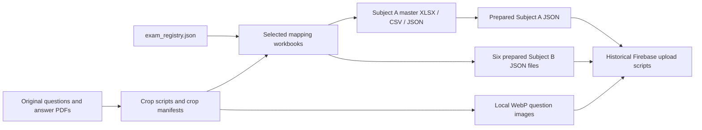

# Exam data audit

Date: **2026-10-21**. All source paths are relative to `D:\ITPEC Old Questions`. Counts are local processed-file counts, not live Firestore counts. Machine-readable details and SHA-256 fingerprints are in [audit evidence](evidence/local-audit-2026-10-21.json).

## Verified facts

### Actual coverage

| Exam ID | Source paper | Processed rows | Source/manifest/image counts | True `is_published` in prepared JSON |
|---|---|---:|---|---:|
| `2023S_FE_AM` | Legacy Morning, classified under Subject A | 80 | 80 / 80 / 80 | 0 |
| `2023A_FE_AM` | Legacy Morning, classified under Subject A | 80 | 80 / 80 / 80 | 0 |
| `2024S_FE_A` | Subject A | 60 | 60 / 60 / 60 | 60 |
| `2024A_FE_A` | Subject A | 60 | 60 / 60 / 60 | 60 |
| `2025S_FE_A` | Subject A | 60 | 60 / 60 / 60 | 60 |
| `2025A_FE_A` | Subject A | 60 | 60 / 60 / 60 | 60 |
| `2026S_FE_A` | Subject A | 60 | 60 / 60 / 60 | 60 |
| `2024S_FE_B` | Subject B | 20 | 20 / 20 / 20 | 20 |
| `2024A_FE_B` | Subject B | 20 | 20 / 20 / 20 | 20 |
| `2025S_FE_B` | Subject B | 20 | 20 / 20 / 20 | 20 |
| `2025A_FE_B` | Subject B | 20 | 20 / 20 / 20 | 20 |
| `2026S_FE_B` | Subject B | 20 | 20 / 20 / 20 | 20 |
| `FE_B_SAMPLE` | Sample questions; not a dated past exam | 20 | 20 / 20 / 20 | 20 |
| **Total** | **460 A + 100 dated B + 20 sample B** | **580** | **580 / 580 / 580** | **420** |

“Source” in the count column means the registry-selected workbook's first sheet. Each question-number range is complete; there are no duplicate question IDs or duplicate numbers within sets. All 580 referenced local images exist and decode with Pillow. Images range from 1,276–1,320 pixels wide and 187–5,339 pixels high. Total image size is **41,246,360 bytes (about 39.34 MiB)**. This verifies file integrity/existence, not that every crop is visually perfect.

The README lists 320 A and 100 B questions; it omits 2023S AM, 2026S A and 2026S B. The registry and processed files provide the current coverage. `database/raw/2023S_FE_PM_Questions.pdf`, `2023S_FE_PM_Answer.pdf`, `2023A_FE_PM_Questions.pdf`, and `2023A_FE_PM_Answer.pdf` exist but have no registered processed PM question set. They must not be counted as processed Subject B questions or silently renamed to B.

### Canonical processed data and lineage

**Subject A:** current reusable prepared payload is `database/firebase_import/questions_subjectA_firestore.json` (460 rows). Its upstream processed master is `database/sorted/master_subjectA_question_bank.xlsx`, with `master_subjectA_question_bank.csv` and `questions_import_subjectA.json` beside it. The sorted JSON and prepared JSON have equal meaningful field values by question ID; prepared JSON adds `firestore_path` and converts some blank strings to null. They are not byte-identical.

**Subject B:** current reusable prepared payloads are these six files, 20 rows each:

- `database/firebase_import/questions_subjectB_2024S_firestore.json`
- `database/firebase_import/questions_subjectB_2024A_firestore.json`
- `database/firebase_import/questions_subjectB_2025S_firestore.json`
- `database/firebase_import/questions_subjectB_2025A_firestore.json`
- `database/firebase_import/questions_subjectB_2026S_firestore.json`
- `database/firebase_import/questions_subjectB_sample_firestore.json`

There is no single unified B master JSON in the inspected resources. For future rebuilds, `database/builder/exam_registry.json` selects these exact workbooks under `database/sorted/`:

| Exam | Active workbook filename |
|---|---|
| 2023S AM | `itpec_fe_2023S_morning_question_map_REVIEWED.xlsx` |
| 2023A AM | `itpec_fe_2023A_morning_question_map_REVIEWED.xlsx` |
| 2024S A | `itpec_fe_2024S_subjectA_question_map_REVIEWED.xlsx` |
| 2024A A | `itpec_fe_2024A_subjectA_question_map_REVIEWED.xlsx` |
| 2025S A | `itpec_fe_2025S_subjectA_question_map.xlsx` |
| 2025A A | `itpec_fe_2025A_subjectA_question_map.xlsx` |
| 2026S A | `itpec_fe_2026S_subjectA_question_map.xlsx` |
| 2024S B | `itpec_fe_2024S_subjectB_question_map.xlsx` |
| 2024A B | `itpec_fe_2024A_subjectB_question_map.xlsx` |
| 2025S B | `itpec_fe_2025S_subjectB_question_map.xlsx` |
| 2025A B | `itpec_fe_2025A_subjectB_question_map.xlsx` |
| 2026S B | `itpec_fe_2026S_subjectB_question_map.xlsx` |
| Sample B | `itpec_fe_sample_subjectB_question_map.xlsx` |

The reviewed 2024 A workbooks additionally contain `Mapping_Summary`, `Manual_Review_Notes`, and `Sources` sheets. Many backups and older CSV/XLSX siblings exist; merging all files would duplicate exams and reintroduce older mappings.



The last step is a future/existing mutation mechanism, not a command executed by this investigation.

### Schemas and stable identifiers

| Concern | Subject A prepared fields | Subject B prepared fields |
|---|---|---|
| Identity | `question_id`, `exam_id`, `question_no`, `firestore_path` | Same, plus `questionId`, `questionNo` aliases |
| Exam provenance | `year`, `season`, `paper`, `format`, `subject`, `subject_key`, `exam_label`, `display_subject`, `canonical_bucket`, legacy fields | Same main exam fields; sample/2026 payloads also carry `display_name`, `source_kind`; `durationMinutes` |
| Correct answer | `correct_answer` | `correct_answer` / `correctAnswer` |
| Choices | No explicit option list; frontend defaults a-d | `choice_count` / `choiceCount`, `answer_options` / `answerOptions`; variable counts, correct letters can reach i |
| Mapping | `book`, `chapter`, `section`, `topic`, `mapped_volume`, `mapped_chapter`, `mapped_section`, `mapped_topic`, `mapped_page`, `related_textbook_pages`, `confidence`, `notes`, `website_tag` | `section`, `topic`, `tags`; no Subject A chapter mapping |
| Images | `question_image_path`, crop review/method/notes | Local image path plus camel alias, `storagePath`/`storage_path`, nullable `questionImageUrl` |
| PDF provenance | `source_pdf`, `source_page_start`, `source_page_end`, `exam_pdf_page` | Source PDF and page range |
| Publication | `is_published` | `is_published`, `isPublished` |
| Teaching content | `free_video_url`, `paid_course_cta` (often blank/placeholders) | No equivalent written explanations |

Examples of immutable question IDs: `2026S-A-Q001`, `2024A-B-Q009`, `2023A-AM-Q002`, `SAMPLE-B-Q004`. Firestore document paths are `questions/{question_id}`. Legacy records retain `paper: AM`, `format: legacy_morning`, `subject_key: subject_a`; classifying them for practice does not change their original paper. Sample B uses `exam_id: FE_B_SAMPLE`, null year and empty season; do not fabricate a date.

The runtime `src/services/questionService.js` normalizes snake/camel aliases, fetches `isPublished == true`, resolves Storage URLs and defaults missing A options to a-d. It is a client adapter, not a static dataset. Questions do not have permanent concept IDs, and a free-text topic label is not a reliable many-to-many key.

### Answers and validation

All **580 processed answers match the corresponding local answer PDF text**. For 12 dated papers, question-number/answer pairs were extracted from the registered answer PDF; sample answers were read from the last page (PDF page 32) of `database/raw/FE-B-SampleQuestions.pdf`. The parser found every expected number and no mismatch. This establishes agreement with the local PDFs, not independent verification against a freshly downloaded official edition.

All A answers are a-d. Each B answer belongs to its exported answer-option list. Option counts must remain per question: the existing B schema and frontend explicitly support more than four choices.

`python -B database/builder/scripts/validate_registered_exams.py` passed: seven A workbooks, manifests, images, 460 question payloads and 460 Storage-manifest entries. The script only validates A. The separate [read-only audit script](evidence/audit_local_resources.py) checked all 13 sets, including B choices, images, PDF answers and crop-review states. Run from the new repo with:

```powershell
python -B docs/investigation/evidence/audit_local_resources.py --source 'D:\ITPEC Old Questions'
```

All crop manifests mark their rows `approved`. A JSON repeats 460 approvals; B JSON drops that review field, although the manifests retain all 120 approvals and the selected B workbooks have `needs_review: False`. 2023S AM has two manual crops and 2026S B has one. Other crop rows are marked auto. Workbook notes identify vertically stitched multi-page B questions.

### Mapping coverage and quality

All 460 A records have chapter, section, topic, mapped-page references, confidence and notes. Chapter labels follow the 14 canonical labels in `builder_common.py` and `CHAPTER_VOLUMES` in `src/App.jsx`. They broadly reflect the two textbook volumes; individual topic/section mappings are project editorial work, not an externally certified exam taxonomy.

| Volume | Chapter | Questions |
|---|---|---:|
| IT Fundamentals | 1 Hardware | 38 |
| IT Fundamentals | 2 Information Processing System | 29 |
| IT Fundamentals | 3 Software | 30 |
| IT Fundamentals | 4 Database | 34 |
| IT Fundamentals | 5 Network | 34 |
| IT Fundamentals | 6 Security | 53 |
| IT Fundamentals | 7 Data Structure and Algorithm | 24 |
| IT Strategy & Management | 1 Corporate and Legal Affairs | 51 |
| IT Strategy & Management | 2 Business Strategy | 62 |
| IT Strategy & Management | 3 Information Systems Strategy | 15 |
| IT Strategy & Management | 4 Development Technology | 50 |
| IT Strategy & Management | 5 Project Management | 15 |
| IT Strategy & Management | 6 Service Management | 16 |
| IT Strategy & Management | 7 System Audit and Internal Control | 9 |
| **Total** | | **460** |

Confidence distribution: **370 High, 89 Medium, 1 Low**. The Low row is `2024A-A-Q053` (blockchain), whose note states that the term is not visibly named in the textbook. The old `itpec_fe_2024A_mapping_review.md` says zero Low rows and therefore does not describe the current reviewed export exactly.

Hardware's 38 questions comprise 33 High and five Medium mappings: 2023S AM 8, 2023A AM 7, 2024S A 4, 2024A A 4, 2025S A 4, 2025A A 6, 2026S A 5. Section strings are inconsistent: cache-memory questions include both `3-5-1 High Speed Memory Access` and `2-1 Computer Architecture`; the latter differs from the actual Hardware contents structure. Page references are human-readable strings, sometimes with both PDF and printed numbering, sometimes only `PDF p... / textbook p...`. Preserve them as raw evidence and review them before assigning structural section IDs.

B has **96 `algorithm_programming`** and **24 `information_security`** questions across its six sets. Its curated sample-video map contains 80 dated-paper classifications (2024/2025), 25 similar-match edges (seven `near_exact`, 18 `same_solving_pattern`), and 48 `doNotMap` entries. This is a recommendation aid, not question deduplication or proof of identical wording. The 2026S set needs explicit new similarity review.

### Material gaps and inconsistencies

1. **Publication flags conflict with review state.** A prepared JSON marks the 160 legacy questions unpublished while every crop is approved. The old uploader calculates camel-case `isPublished` from image upload success and approval, ignoring the stored false flag, and merges it into Firestore. Local payloads therefore cannot establish which records the live app currently exposes. A new import must require an explicit publication decision and retain both original and new decisions.
2. **Structured stems, option text and written answer explanations are absent from all seven prepared JSON payloads.** The UI displays question images, answer letters, chapter/topic metadata and external videos. All A rows have mapping notes, which may help draft explanations but are not complete reviewed solutions. The untracked landing demo has one transcription; it is not a general text bank.
3. **All 120 populated A `free_video_url` values are placeholder identifiers** such as `free-video-2025S-A-Q001` and `free-video-2026S-A-Q001`, not playable URLs. A's real lecture catalog has 43 Telegram links; B's 20 sample lessons also use Telegram, including one `t.me/c/` accessibility warning. No usable YouTube catalog was found in these mapping assets.
4. **Historical uploads do not prove live coverage.** Latest `upload_report_subjectA.json` records 60 images and 60 writes on 2026-08-20, with zero failures. It is a report for the latest filtered upload, not an inventory of all 460. Six B upload reports record 20 writes each. Do not run an importer or a credentialed audit to infer more during Phase 1.
5. **Images need accessibility and mobile adaptation.** Every stem/choice is readable visually but not represented as semantic text. Long B images need zoom and readable scaling; add accurate text/transcripts and figure alt text progressively.

## Assumptions

- Local answer PDFs represent the intended answer editions. Any later official correction should create a documented revision without changing the source question ID.
- Stored approval/confidence flags describe prior editorial work. They do not replace a fresh review of the Chapter 1 pilot.
- 580 is a reusable corpus candidate count; it is not a promise that all 580 may be published immediately. “Past exam” counts should exclude the 20 sample items by default.

## Recommendations

Freeze a provenance-preserving snapshot from the prepared JSON, registry-selected workbooks and local images. Normalize aliases and blank/null values in a separate adapter. Use ID-keyed comparisons and validation reports, with no dependency on production Firestore. Preserve original `sourcePublication` and create a separate reviewed `publication.status`; never fix the legacy flag discrepancy in the old repository.

Start concept mapping with Hardware's 38 candidate questions. Review the five Medium rows and inconsistent section/page labels. Validate every displayed concept count against the set of distinct, published, approved question-concept edges; a broad chapter total must not be presented as the count for an individual highlighted concept. See [mapping design](05_DATA_MAPPING_DESIGN.md).
