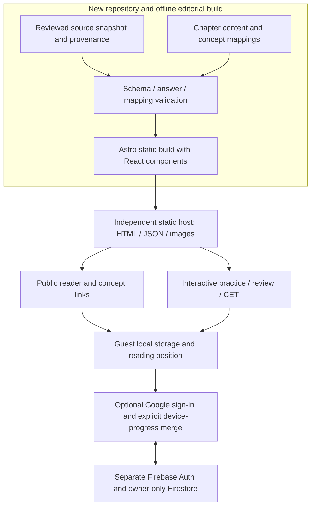

# Architecture options

Date: **2026-10-21**. Recommendations below are design decisions for approval, not infrastructure that has been created. Vendor documentation was checked on this date; recheck quotas before launch.

## Verified facts

The new repository contains only a README. The old app is React/Vite with client-side React Router, Firebase Auth/Firestore/Storage and Firebase Hosting. Its `index.html` has an empty React root, `SeoHead` mutates metadata in the browser, `vite.config.js` has React/Tailwind plugins without prerendering, and Hosting rewrites every route to `/index.html`. These are source observations, not a claim that search engines cannot render React.

The intended product has long-lived public textbook pages, a finite question bank, guest progress and optional cloud backup. No requirement currently needs a long-running server, server-side personalization, paid API, compute instance or runtime CMS. Approximately 39.34 MiB of current question images and about 1.04 MB of prepared question JSON can be shipped as partitioned static assets. Original source data need not be fetched from production Firestore at runtime.

### Framework comparison

| Approach | SEO / initial reading | Reuse and implementation work | Operating model | Assessment |
|---|---|---|---|---|
| Retain React + Vite SPA | Works after client rendering; no chapter HTML from current setup | Most familiar; reuse React UI directly; still needs entirely new content/reader/data layer | Static files, optional Firebase | Viable for practice, weaker fit for a content-led public textbook without a rendering addition |
| React + Vite with a maintained prerender/SSG integration | Can generate per-chapter/section HTML | Preserves React/Router knowledge; must select and validate integration, head handling, hydration and route generation | Static build; no runtime server required | Reasonable fallback if staying with the existing routing approach is strongly preferred |
| **Astro static pages + React interactive components** | Prebuilt reader HTML; hydrate quiz/dashboard/auth only where needed | Reuse React presentation/pure logic; add Astro layouts/content schemas and adapters; avoid sharing one React context across isolated islands | Static build and hosting; optional Firebase client sync | **Recommended for this new content-heavy app** |
| Next.js static export + client practice UI | Prebuilt public pages with React | React throughout; all finite paths enumerated at build; browser-only old services require isolation | Static export can use ordinary static hosting | Viable React-first alternative; additional conventions bring limited immediate benefit over Astro here |
| Next.js/other framework with runtime SSR and managed backend | Dynamic HTML and personalization | More deployment/auth/cache integration | Server/functions and potential usage bills | No demonstrated need for the current scope |

Astro renders static HTML by default and can hydrate React islands explicitly; this matches a reader with targeted interactivity. [Astro islands documentation](https://docs.astro.build/en/concepts/islands/) supports this capability. Its content collections provide schema-validated content/data loading. [Content collections documentation](https://docs.astro.build/en/guides/content-collections/).

Next.js supports static export with precomputed paths, but runtime cookies, server actions, ISR and dynamic routes that cannot be generated at build time are among its unsupported export features. [Next.js static export documentation](https://nextjs.org/docs/app/guides/static-exports). Vite's native SSR API is low-level and aimed at framework/library integration; building a custom rendering stack solely for this site would add maintenance. [Vite SSR documentation](https://vite.dev/guide/ssr.html).

The framework recommendation is an **inference from the product's static reading requirements and the inspected code**. No performance benchmark was run. It is not a recommendation to rewrite the existing production app: React remains reusable, and the new repository has no application to migrate. Astro also uses Vite internally; the meaningful change is adding structured static rendering and routing.

### Hosting and cost comparison

| Option | Current documented limits / implications | Suitability |
|---|---|---|
| **Cloudflare Pages Free, static output only** | Static asset requests are free and unlimited when Functions are not invoked; Free plan has 500 builds/month, 20,000 files/site and 25 MiB/asset | Good initial default for chapter HTML, JSON and WebP assets. No Functions, Workers compute, R2 or paid plan needed for this design |
| Firebase Hosting Spark, separate new project | 10 GB hosting storage and 10 GB/month transfer at no cost; after grace period an exhausted Spark transfer quota can disable the site until reset | Good single-vendor alternative. Images can live in Hosting rather than Cloud Storage; monitor image traffic |
| Existing practice Firebase project/bucket | Current rules, data and production app already share that project; runtime reuse would couple releases, quotas and access | Avoid for the textbook |
| Firebase Cloud Storage for new images | Current requirement is Blaze to provision/use Cloud Storage; billing linkage is required | Unnecessary for immutable bundled question images; avoid in the initial design |
| Runtime SSR / Firebase App Hosting / custom VM | Adds services the known requirements do not need | Do not provision |

Sources: [Cloudflare static asset pricing](https://developers.cloudflare.com/pages/functions/pricing/), [Pages limits](https://developers.cloudflare.com/pages/platform/limits/), [Firebase Hosting quotas](https://firebase.google.com/docs/hosting/usage-quotas-pricing). Cloud Storage's Blaze requirement took effect starting February 3, 2026; older claims that a new Firebase image bucket can simply stay on Spark should not guide this project. [Firebase Storage changes](https://firebase.google.com/docs/storage/faqs-storage-changes-announced-sept-2024).

Domain registration/renewal is separate. “Free public site” does not promise unlimited free cloud synchronization. Cloudflare plan policies, auth quotas and real Myanmar network performance must be checked at launch; the repository alone cannot establish them.

### Optional Firebase sync budget

Firestore's documented no-cost quota is 1 GiB stored data, 50,000 document reads/day, 20,000 writes/day, 20,000 deletes/day and 10 GiB/month outbound transfer, with one free database per project. [Firestore quotas](https://firebase.google.com/docs/firestore/quotas).

Illustrative planning assumptions, **not measured usage**: 200 signed-in daily learners × 30 changed attempt records = 6,000 attempt writes/day, leaving room for reading positions, bookmarks and session metadata if only changed documents are written. A delta download of 50 documents per learner would be 10,000 reads/day. At 1,000 such learners, attempts alone would be 30,000 writes/day and exceed the current free write quota. Full-history rewrites and repeated full-collection reads would make costs/limits worse.

Keep the new Firebase project on Spark initially, using Google Auth and Firestore only, subject to their current applicable quotas and enabled auth configuration. Do not attach billing as an incidental setup step. On sync quota/error, queue local progress and show a retry status; static reading and guest practice remain available. Offer local export/import so a learner has a recovery path independent of a cloud provider. Billing alerts on any later paid plan would be notifications rather than a hard spending cap.

## Assumptions

- Content updates are editorial releases rather than changes every few seconds; rebuilds are acceptable.
- Signed-in usage initially fits free quotas. There is no traffic forecast supplied, so sustained zero cloud cost cannot be guaranteed.
- The team can adopt a thin Astro content layer while retaining React for quizzes. If that learning cost is unacceptable, a proven React prerendering integration is the next candidate to validate.
- A first-party account system for this new site is sufficient. Cross-domain accounts/progress shared with the old practice site were not requested and are not included.

## Recommendations

### Proposed application boundaries

The old practice repository is a read-only source during an approved future snapshot operation. It is not an importable runtime package, shared database, build-time online dependency, shared deployment target or image CDN. Store a snapshot manifest with commit, path, hashes and source edition. Copy only selected resources and reviewed code into the new repo; do not copy `.env`, secrets, upload reports with tokenized URLs, logs, tracking scripts, or Firebase deployment defaults. The new repository is public, so content intended only for editorial review needs a separate publication decision.

### Static reading and responsive UI

Generate a public HTML page for every published chapter/section with stable headings, canonical metadata, description, breadcrumbs and sitemap entries. Serve real 404s for unknown content. Ensure useful chapter text and ordinary navigation links work before JavaScript loads. Keep private progress/dashboard routes out of indexing, and do not embed personal data into shared HTML or JSON.

Use static semantic prose for the reader; small browser code captures/restores position. Hydrate a single coherent React practice app on the practice screen, and a focused dashboard/auth component where needed. Avoid assuming React context is shared across separately hydrated islands. Use an explicit storage/event adapter for guest state. The right companion can use static recommendations plus a small progress widget.

On desktop, implement the approved left navigation / center reader / right companion. On mobile, prioritize the reader, move navigation to an accessible drawer, and place companion help in a collapsible or below-content region. Yellow concept links must have keyboard focus, a useful accessible name and a visible affordance beyond color. No redundant blue concept-action box. Load current question images and necessary adjacent assets; declare image dimensions and avoid fetching all 580 images to display one concept.

### Data delivery and counts

Author reviewed prose as Markdown/MDX or a typed block format, alongside JSON/YAML textbook metadata and many-to-many mappings. Build per-exam question files, per-concept ID indexes and a compact availability manifest. Generate counts from eligible distinct IDs, not a stored marketing number or heuristic search at runtime. Keep answers public for learning; CET is a formative assessment, not a secure examination. Use content-hashed asset filenames and a dataset version to invalidate stale caches safely. Optional offline caching can follow after the core reading-return flow is reliable.

### Firebase security and privacy

Use a separate project with dedicated allowed domains and new configuration. Load its SDK lazily when sync is enabled; missing Firebase configuration must not prevent guest reading. Firebase web API keys identify a project and are designed to appear in the client; authorization depends on rules/IAM and applicable App Check, with appropriate API restrictions. Service-account credentials remain private and must never enter public code, build artifacts or client environment fields. [Firebase API key guidance](https://firebase.google.com/docs/projects/api-keys).

Keep all cloud progress under `users/{uid}/...`, with ownership enforced by `request.auth.uid == uid`, collection-specific field/type/size validation and default deny. No public listing of users or progress. Reject writes to official content collections; official textbook/question data are served statically. Treat any client-supplied role as untrusted. Validate IDs, bounded payloads and timestamps; do not authorize access by a user-editable profile flag. Test unauthenticated access, cross-user reads/writes and malformed owner writes in dedicated emulators before enabling sync. Owner access patterns follow [Firebase rules guidance](https://firebase.google.com/docs/rules/basics/).

The existing rules establish owner boundaries but allow arbitrary owner writes recursively. The existing progress code uses one global guest cache, leaves merged local progress after sign-out, can hydrate and sync via concurrent sign-in paths, merges some topic counters additively across guest IDs, and saves many accumulated documents in one batch. These are code-level reasons to adapt it. Multi-account leakage and duplicate/lost progress are **risks inferred from those behaviors**, not defects reproduced against real users.

Scope local caches by guest identity or signed-in UID. On sign-in, offer a clear choice to merge this device's guest progress; on account change/sign-out, prevent the previous user's cache from entering another account. Store stable attempt IDs and sync changed records idempotently. Do not add aggregate counters repeatedly; derive summaries from deduplicated attempts or verified per-device deltas. Preserve bookmark deletion with tombstones, bound sync history and acknowledge only successfully saved changes. Use explicit retry/backoff and delta pagination instead of repeatedly downloading all history.

Minimize stored personal data: UID plus learning records is enough for sync. Display name/avatar can come from the auth session; persisting email/photo/profile copies is optional and unnecessary initially. Provide local reset/export, cloud progress deletion and a clear data-retention policy. Deleting progress and deleting the Firebase Auth account are distinct actions and must both be available when accounts ship. External video playback should begin with an ordinary user-initiated link or a consented embed; no YouTube API key or backend recommender is needed.

### Decision for approval

Adopt **Astro static pages with React practice components**, a new independent static host (Cloudflare Pages Free as the initial candidate), local-first guest progress, and **optional Firebase Google Auth + Firestore on a separate Spark project** in a later phase. Keep images/content on static hosting. First validate this choice with one Chapter 1 reading/practice/return slice, HTML inspection without JS and mobile testing. No infrastructure has been provisioned, and no feature implementation starts until Phase 1 approval.
