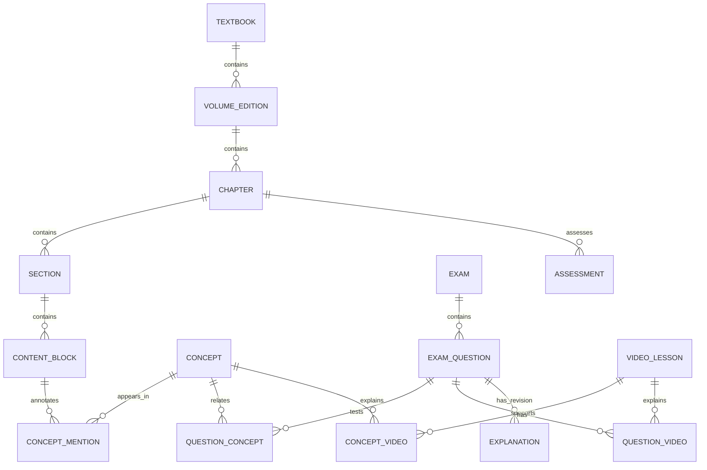

# Textbook, concept, question and video mapping design

Date: **2026-10-21**. This is a proposed schema and editorial workflow. No application models, migrations, imports or cloud collections have been created.

## Verified facts

- The existing corpus has 580 unique original question IDs, 13 exam IDs, source PDFs/page ranges, answer letters and local image crops. Two legacy AM sets must retain their original provenance; the sample B set has no exam year.
- Subject A currently has one chapter/section/topic tuple per question plus mapping confidence and raw page-reference strings. This cannot express all question-to-concept relationships reliably.
- Both textbook volumes restart chapter numbering at 1. A chapter number alone is not a unique key.
- Existing source material provides textbook sections but no stable section/block/concept IDs. Topic names and section labels vary between exams.
- Lecture catalogs use tags/chapter matching for A and curated exact/similar question matching for B. They are primarily Telegram resources, not a YouTube catalog.
- No completed textbook reader, exact reading-position state or CET data model exists in the inspected application.

## Assumptions

- The product groups two source volumes under one ITPEC FE textbook experience, while preserving edition-specific source references.
- Concepts can recur in multiple sections and several concepts can be needed to solve one question. The same question remains one record when linked from multiple concepts.
- CET provisionally means chapter-end test and is formative. The assessment name and policy need agreement before implementation.
- Examples below propose new IDs/paths/statuses. They are **not** existing files, completed editorial decisions or claims that the suggested concept associations have been approved.

## Recommendations

### Entity model



| Entity | Required fields / relationships | Purpose |
|---|---|---|
| `Textbook` | `id`, title, language, ordered volume-edition IDs, content version | Product-level collection |
| `VolumeEdition` | `id`, textbook ID, volume number/title, edition label, source-file fingerprint, source rights/attribution record | Distinguishes the two volumes and later editions |
| `Chapter` | Stable ID such as `fe-v1-ch01`; edition ID, number, title, slug, section order | Unique even when both volumes have a Chapter 1 |
| `Section` | Stable ID such as `fe-v1-ch01-s02-03-04`; chapter/parent-section IDs, title, slug, order, source references, status | Nested source hierarchy with stable links independent of title changes |
| `ContentBlock` | Persistent block ID, section ID, type, body/figure/table/math, source references, revision | Reading anchors and verifiable editorial units |
| `Concept` | Global stable ID, label, aliases, short definition, related/prerequisite IDs, editorial state | One concept can be mentioned in different chapters/sections |
| `ConceptMention` | Mention ID, concept ID, block ID, inline AST mark/range, display label, optional practice scope | Yellow highlight is an explicit authored link, not a global regex over prose |
| `Exam` | **Original `exam_id`**, date metadata, paper/format, source kind, source PDFs/hashes, expected count | Canonical provenance, including legacy AM and sample distinctions |
| `ExamQuestion` | **Original `question_id`**, exam ID, number, source paper/format, answer/options, image asset ID, optional semantic stem/options, original mapping/publication fields, new publication decision | Exactly one record per source question |
| `QuestionConcept` | Composite key `(questionId, conceptId)`, role, relationship, evidence, confidence, review state/reviewer/review date | Many-to-many relation; role can be primary or supporting |
| `SourceReference` | Source edition/file ID, SHA-256, physical PDF page range, printed labels, optional bounding boxes, original raw reference | Preserves both machine-usable coordinates and imperfect legacy mapping evidence |
| `Asset` | ID, local source path/hash, published URL/hash, media type, width/height, alt/caption, rights record | Own-hosted images; no old Firebase token dependency |
| `Explanation` | Question ID, revision, answer rationale, optional distractor rationale/worked steps, citations, reviewer/state | Independent authored explanation; answer-key correction history remains auditable |
| `VideoLesson` | Stable ID, platform, URL/video ID, title, language, free access, access verification date/status, license/embed status if relevant | YouTube and Telegram are explicit platforms; placeholders cannot qualify |
| `ConceptVideo` | Concept ID, video ID, relevance/level, review state | Concept-oriented teaching support |
| `QuestionVideo` | Question ID, video ID, `exact` / `near_exact` / `same_solving_pattern`, evidence, review state | Preserves conservative existing B matching semantics |
| `CourseOffer` | ID, paid/free marker, destination, disclosure, relevant concepts, display policy | Optional course suggestion kept separate from free lessons |
| `Assessment` / `AssessmentItem` | Definition/version, chapter/section/concept scope, question references, policy, selection rules, scoring | CET definitions; items may reference exam questions or separately identified original exercises |

Do not use chapter titles, display slugs, question array positions, image names or video titles as primary keys. Slugs may change with a redirect/alias record; immutable IDs stay stable. New authored exercise IDs (for example `exercise:fe-v1-ch01-q001`) must not imitate official exam question IDs. Preserve the original unnormalized row in a private/editorial snapshot where appropriate; publish only the fields required for learning/provenance.

### Example adapter record using verified source values

The following is a **proposed normalized representation** of a real source record. The original fields below were verified in `database/firebase_import/questions_subjectA_firestore.json`; the asset ID, status vocabulary and field grouping are proposed. `answerKeyChecked` refers only to agreement with the local answer PDF.

```json
{
  "id": "2025A-A-Q002",
  "examId": "2025A_FE_A",
  "questionNo": 2,
  "subjectKey": "subject_a",
  "paper": "A",
  "format": "subject_a",
  "sourceKind": "past_paper",
  "answer": { "correctOptionId": "c", "optionIds": ["a", "b", "c", "d"] },
  "imageAssetId": "question-image:2025A-A-Q002",
  "stem": null,
  "optionText": null,
  "source": {
    "questionPdfPath": "database/raw/2025A_FE-A_Questions.pdf",
    "pdfPages": { "start": 4, "end": 4 },
    "legacyImagePath": "database/builder/output_images/question_images/subject_a/2025A/q002.webp",
    "rawTextbookReference": "PDF p48-49 / textbook p43-44"
  },
  "sourceMapping": {
    "chapter": "Chapter 1 Hardware",
    "section": "2-3-4 Shift Operation",
    "topic": "Two’s complement + left shift + addition/subtraction"
  },
  "sourcePublication": { "isPublished": true, "imageReviewStatus": "approved" },
  "publication": { "status": "pending_review" },
  "answerKeyChecked": true
}
```

Fill source PDF/image hashes from the approved snapshot manifest during the future adapter step. Do not fill them with invented digests. For B, take the explicit `answer_options`/`choice_count` rather than synthesizing a-d. For `2023A-AM-Q002`, preserve `examId: 2023A_FE_AM`, `paper: AM`, `format: legacy_morning` and the source false publication flag; the new reviewed decision is independent. Never use `question.subject == A` to overwrite `paper == AM`.

### Many-to-many mapping examples

Candidate edges grounded in current topics/notes:

| Original question ID | Proposed concept ID | Evidence / state |
|---|---|---|
| `2025A-A-Q002` | `bit-shifts` | Topic explicitly contains left shift; candidate |
| `2025A-A-Q002` | `twos-complement` | Topic explicitly contains two's complement; candidate |
| `2023A-AM-Q002` | `bit-shifts` | Topic and notes explain a left shift and subtraction for 7 × n; candidate |
| `2024A-A-Q009` | `cache-memory` | Topic is effective/average cache access time; candidate |
| `2024A-A-Q009` | `weighted-average-access-time` | Proposed supporting concept for the calculation; requires question/editor review |

This already expresses one question linked to several concepts, and the same concept linked to several questions. The actual stored graph would use rows like:

```json
{
  "questionId": "2025A-A-Q002",
  "conceptId": "bit-shifts",
  "role": "primary",
  "relationship": "tests",
  "evidence": {
    "sourceField": "topic",
    "sourceValue": "Two’s complement + left shift + addition/subtraction"
  },
  "confidence": "candidate_from_existing_mapping",
  "review": { "status": "pending", "reviewerId": null, "reviewedAt": null }
}
```

Section `fe-v1-ch01-s02-03-04` would represent Shift Operation, using its source heading after confirmation. A mention inside a persistent block points to `bit-shifts` and an ordinary practice link such as `/practice/concept/bit-shifts/`. The same concept can have another mention in a later algorithm section. A phrase alone does not create a new concept or duplicate question.

There are **five cache-memory candidate questions** in current Hardware topic metadata: `2023A-AM-Q012`, `2023S-AM-Q013`, `2024A-A-Q009`, `2025S-A-Q010` and `2026S-A-Q010`. Their scope includes calculation, cache misses and write-back; narrower concepts may have fewer matches. `DNS cache poisoning` is a different concept despite sharing the word “cache.” Do not publish “5 related questions” as a reviewed concept count merely because this candidate list exists.

### Derived question indexes and truthful counts

Build a `conceptId -> sorted distinct questionIds` index from the **same eligible set used by practice navigation**:

1. New question publication is `published`.
2. The question-concept edge is approved and the question has a usable image/text representation and valid answer/options.
3. Apply explicit filters: subject, source kind, legacy inclusion and optional current-section scope.
4. Deduplicate question IDs, then apply a deterministic exam/date/number order. Sample dates remain null and sort by an explicit policy.

Concept count = length of this result. Section/chapter practice counts are the union of eligible question IDs for their approved concept scope; a question associated with two section concepts is counted once. Keep direct legacy chapter assignment as a separate audit/fallback view, not an invisible second source of concept membership. A chapter-wide practice link may use the reviewed direct chapter set if clearly labeled as such.

No manually entered “exam frequency” count should drive the UI. Show the exact source filter and data version when useful. If no eligible matches exist, show “No linked questions yet” and retain the concept explanation; do not route to unrelated questions or imply the concept is unimportant. A dataset update recomputes the indexes and counts in one build. The current verified number **38** is a broad Hardware mapping count; final concept counts await edge review.

### Video mapping example

The existing A catalog includes `memory-hierarchy`, title `HDD RAM Register Cache`, URL `https://t.me/itpecmm/101`, tags `hdd`, `ram`, `register`, `cache`, `memory-hierarchy`. A proposed imported resource can retain a stable ID `legacy-a:memory-hierarchy`, `platform: telegram`, `access: free`, and `verification.status: unverified`. Its relationship to `cache-memory` is a review candidate, not an exact solution for every cache question.

Add YouTube lessons only with real reviewed video IDs/URLs, language and concept/question relevance. Do not relabel a Telegram post as YouTube or convert the `free-video-*` placeholders into links. Preserve the B map's exact/near-exact/same-solving-pattern distinctions; `same_topic_only` is insufficient for an exact-answer recommendation. Check `SAMPLE-B-Q004`'s `t.me/c/` link before exposing it as a free public resource. Track dead/private links and provide another lesson or a clear no-video state.

### Reading position and practice context

Use separate structures for a durable reading location and an individual practice session. A proposed reading record contains:

```json
{
  "textbookId": "itpec-fe",
  "editionId": "fe-v1-2015",
  "sectionId": "fe-v1-ch01-s02-03-04",
  "blockId": "fe-v1-ch01-s02-03-04-b003",
  "mentionId": "mention-bit-shifts-01",
  "offsetWithinBlockPx": 72,
  "scrollYFallback": 1240,
  "contentVersion": "pilot-1",
  "updatedAt": "<actual client timestamp>"
}
```

The IDs, offsets and version above are illustrative, not measured reader state. On concept activation, save the clicked mention, nearest block and offset **before** navigation. Put a generated session ID in history/session storage; retain the exact question-ID set and dataset version for that session. Keep an ordinary section/anchor link for no-JS navigation and refresh recovery. Do not put auth tokens or private learning history in URLs.

On “Return to textbook” and browser Back, resolve the stored section/block/mention, allow layout to settle (including fonts and known image dimensions), restore offset and return keyboard focus to the concept link. Use the nearest stable anchor if the content revision removed a block. Raw pixel scroll alone is insufficient across mobile widths and content updates. Validate all return destinations as known same-origin reading routes, avoiding arbitrary `returnTo` redirects. Session context is local and temporary; only a compact latest-reading record belongs in optional cloud sync.

### Guest progress and optional synchronization

Store attempts with stable generated IDs, `questionId`, content/answer revision, selected option, correctness, session/assessment ID, device ID and timestamp. Preserve question provenance by reference. Keep private records separate from static public content. Use IndexedDB for growing attempt history/outbox; small namespaced localStorage records can hold settings and reading pointers. Provide an in-memory fallback/message when persistent browser storage fails.

Use local namespaces such as `itpecTextbook:v1:guest:{guestId}` and `itpecTextbook:v1:user:{uid}`. A merge claims specific guest attempt IDs once after the user's choice, and cloud writes use those IDs for idempotency. Never repeatedly add total counters from two snapshots. Derive mastery summaries from deduplicated attempts, distinguishing first/latest/all attempts explicitly. Bookmarks and deletions use revision/tombstone metadata so a second device does not resurrect deleted items.

Suggested separate Firestore paths are `users/{uid}/attempts/{attemptId}`, `reading/{editionId}`, `bookmarks/{bookmarkId}` and `assessmentAttempts/{attemptId}`. They are proposed new-project paths, not collections to create in the old project. Sync only changed documents and use bounded paginated reads/outbox batches. Owner rules and validation apply to every path. Account switch/sign-out must select the correct local namespace; cloud sync never becomes a prerequisite for answering a question.

### CET design boundary

Version each assessment definition with chapter/section/concept objectives, source selection policy, question count, optional timer, answer/explanation release policy, scoring and retake rules. Capture selected question IDs and their answer revision at attempt start. An imported textbook exercise and an official exam question remain different source kinds. Do not silently change an in-progress test after a dataset update. Mastery/struggle thresholds are product decisions; do not present a heuristic chapter score as an official exam-readiness measure.

### Future build validation

Reject duplicate IDs, dangling graph edges, invalid answer options, missing published assets, unresolved source ranges and placeholder video URLs. Report unreviewed edges and edition/page ambiguities. Check concept/section/chapter counts against deduplicated eligible question sets. Validate that every highlighted mention has a defined concept and usable destination, every referenced explanation exists in its declared review state, and every generated public asset is on the new site's host or an explicitly approved external source. Keep the raw 580-record audit separate from the release's published subset.
